<div align="center">

<h1>LocalKaam &nbsp;·&nbsp; <sub>लोकल काम</sub></h1>

<p><strong>India's zero-commission hyperlocal services marketplace — connecting Mumbai households directly with verified neighbourhood tradespeople.</strong></p>

[](https://coderssujal.vercel.app)
[-2ea44f?style=for-the-badge&logo=nodedotjs&logoColor=white)](https://coderssujal.vercel.app)
[](https://coderssujal.vercel.app)
[](https://coderssujal.vercel.app)
[](https://coderssujal.vercel.app)
[](LICENSE)

*National Level Hackathon · Track: Open Innovation & Hyperlocal Infrastructure*

**Team Lead:** Harsh Singh &nbsp;|&nbsp; Sujal Gupta · Swapnil Singh · Utsav Singh · Deepak Vishwakarma · Sumit Singh

[**Live App**](https://coderssujal.vercel.app) · [What It Solves](#-the-problem) · [How It Works](#-how-it-works) · [Screenshots](#-screenshots) · [Architecture](#%EF%B8%8F-architecture) · [Tech Stack](#-tech-stack) · [Test Suite](#-test-suite) · [Team](#-team)

</div>

---

## 🧩 The Problem

India's gig economy for blue-collar trades is broken in two ways:

| Pain Point | Reality |
|---|---|
| **Exploitative commissions** | Platforms like Urban Company take **25–40%** from every job |
| **City-wide dispatch** | Workers travel 20–40 km, arriving exhausted and late |
| **Opaque pricing** | Customers have no input; prices surge without explanation |
| **No arrival trust** | SMS-based OTPs fail, spoofs are common |
| **No pre-visit diagnosis** | Workers show up unprepared; costs balloon on-site |

**LocalKaam** eliminates all five. It's a street-level, two-sided marketplace where every rupee the customer pays goes directly to the worker — with cryptographic trust, real-time negotiation, and AI-powered pre-visit diagnosis built in.

---

## 🖼️ Screenshots

### Landing & Discovery

| Hero — Live Trade Marketplace | Customer Discovery with Locality Filter |
|:---:|:---:|
| 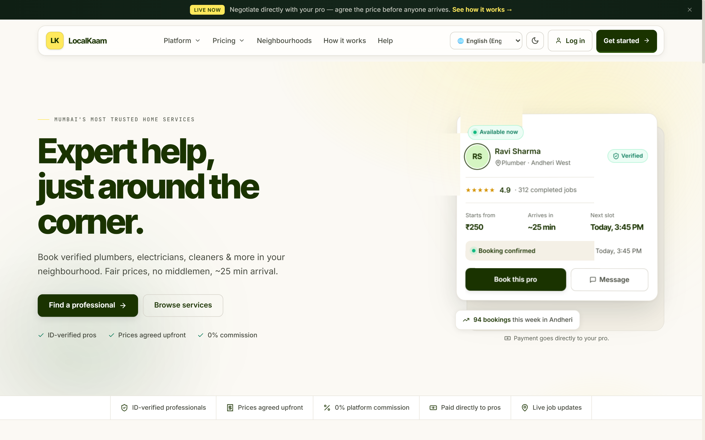 | 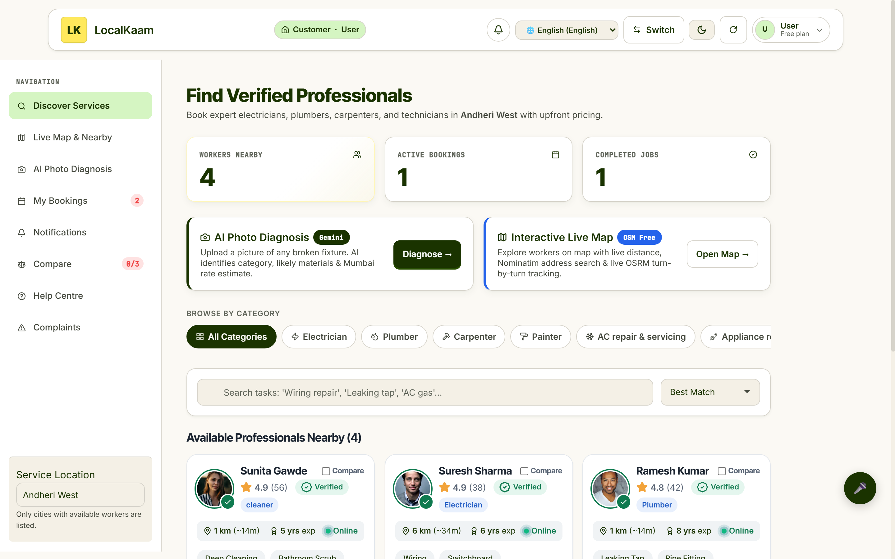 |
| *12-trade grid with locality chips and 120 FPS GPU scroll* | *Verified specialist cards filtered by Andheri West with upfront rates* |

---

### Bookings, OTP & AI Diagnosis

| Booking Panel & In-App Arrival OTP | AI Multi-Modal Photo Diagnosis |
|:---:|:---:|
| 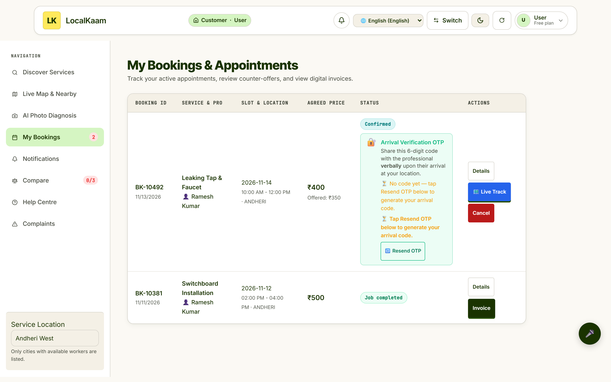 | 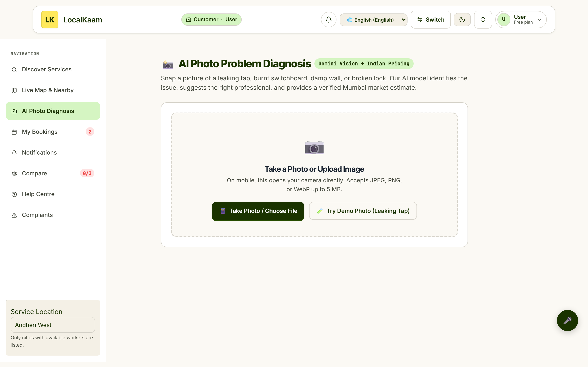 |
| *6-digit cryptographic OTP with live status and milestone tracking* | *Gemini 1.5 Flash — identifies damage, parts needed & repair cost range* |

---

### Worker Dashboard & Admin Analytics

| Worker Console & Live Availability | Active Jobs & Doorstep OTP Verification | Admin Analytics |
|:---:|:---:|:---:|
| 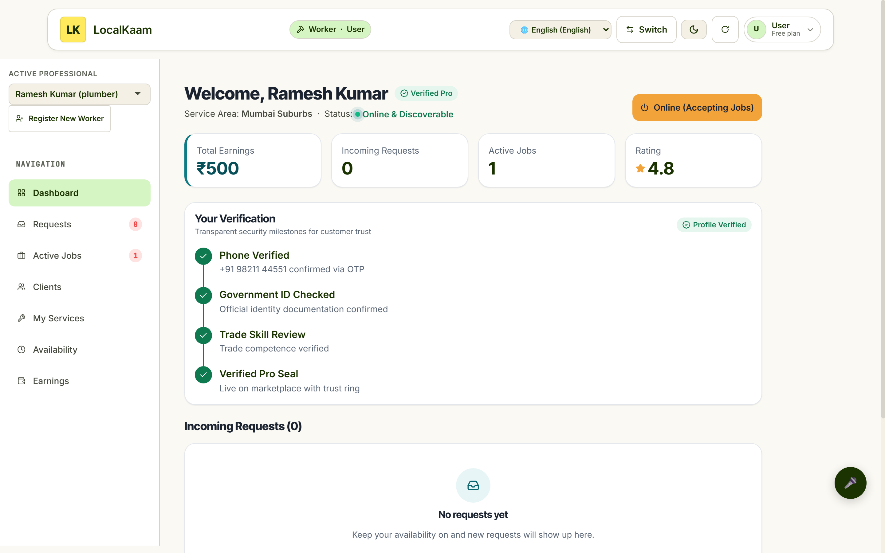 | 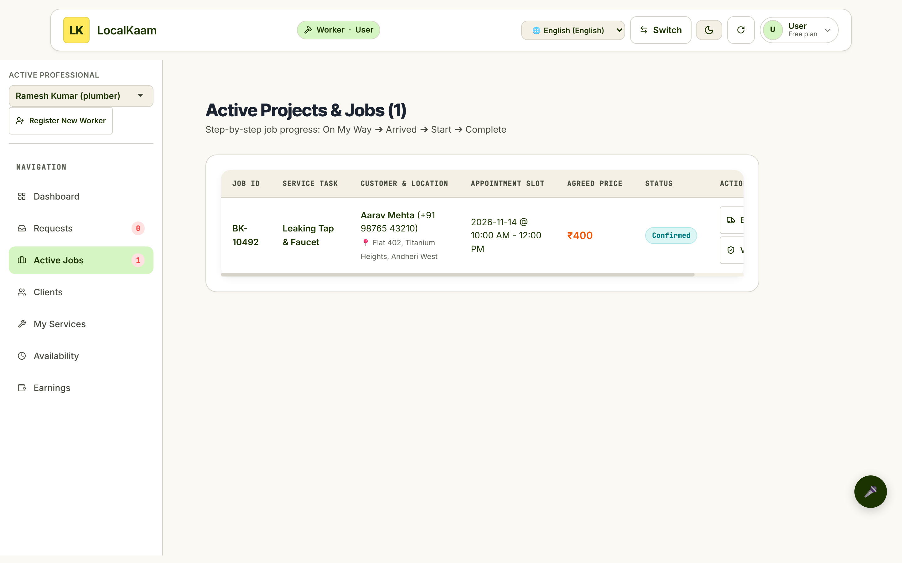 | 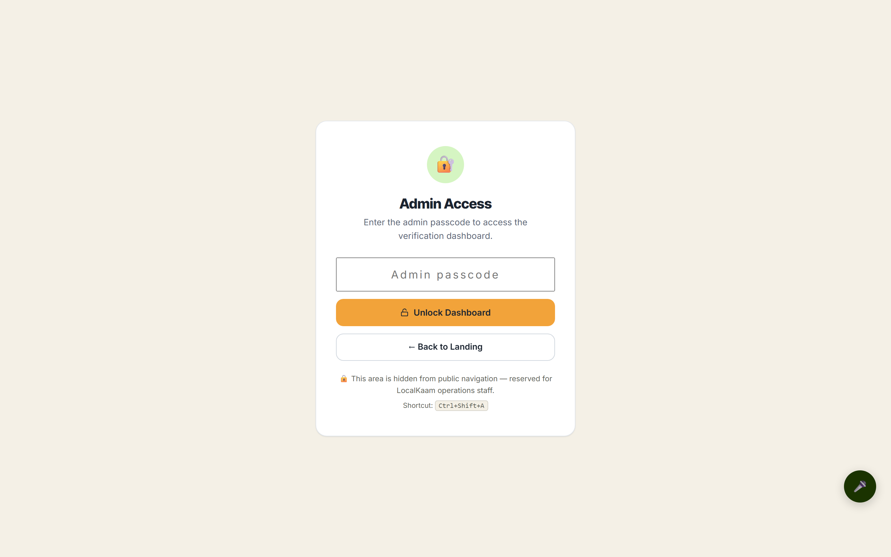 |
| *1-click toggle, request queue, earnings tracker* | *On My Way → Arrived (OTP) → Completed milestone flow* | *Platform-wide bookings, earnings & activity analytics* |

---

### Mobile & PWA Experience

| Mobile Landing | Customer Discovery | Customer Arrival OTP | Worker OTP Verify |
|:---:|:---:|:---:|:---:|
| 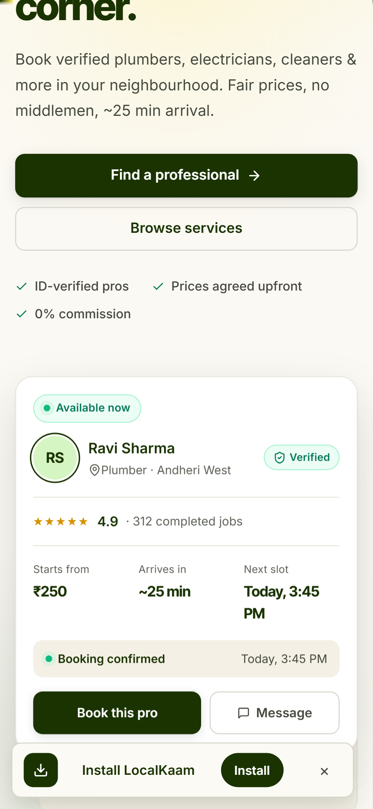 | 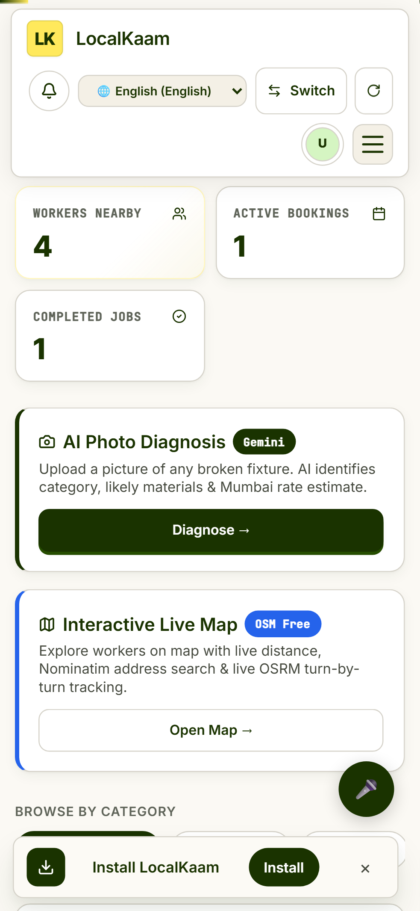 | 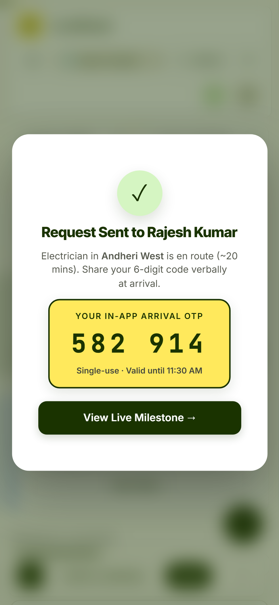 | 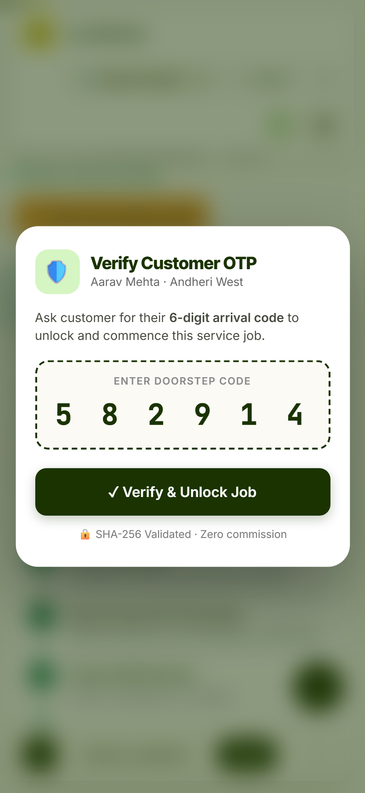 |
| *Fluid 2-column trade grid* | *Neighbourhood pro cards* | *OTP dialog over glassmorphism blur* | *SHA-256 doorstep verification* |

---

## ✨ Key Differentiators

| Dimension | Traditional Platforms | LocalKaam |
|---|---|---|
| **Platform Cut** | 25–40% deducted from worker | **0%** — 100% direct payout |
| **Pricing** | Black-box surge algorithms | **Bilateral negotiation** in-app |
| **Dispatch Radius** | City-wide (20–40 km) | **< 5 km** via Haversine geometry |
| **Arrival Verification** | Delayed SMS / insecure calls | **Cryptographic in-app OTP** (SHA-256) |
| **Pre-Visit Triage** | Opaque on-site surprise | **AI photo diagnosis** (Gemini 1.5 Flash) |
| **Bundle Size** | 15 MB+ framework bundles | **0 kB framework runtime** — < 200 ms load |
| **Scroll Performance** | Variable 30–60 FPS | **Locked 120 FPS** GPU compositor |

---

## 🔄 How It Works

The marketplace runs two parallel flows simultaneously — one for the customer, one for the service professional.

```
  CUSTOMER                                    SERVICE PRO
  ────────                                    ───────────
  Browse by trade + locality           →      Appear in filtered listings
  Propose budget (e.g. ₹450)          →      Accept or counter-offer (live)
  Receive unique 6-digit in-app OTP   →      Tap "On My Way" / "Arrived"
  Share OTP verbally at door          →      Enter OTP to cryptographically unlock job
  Track real-time job milestones      →      Tap "Complete" → instant 100% payout
```

**AI Photo Diagnosis (pre-booking):** Customers photograph the problem (leaking pipe, faulty switch). Gemini 1.5 Flash identifies the issue, estimates parts needed, and gives a repair cost range — before anyone shows up.

---

## 🏛️ Architecture

LocalKaam is a **zero-framework, full-stack** web application. The client runs entirely on native ES Modules with no bundler or framework, communicating with a Node.js backend over REST, Server-Sent Events (SSE), and WebSocket.

```
┌────────────────────────────── Browser (Native Client) ──────────────────────────────┐
│                                                                                      │
│  app.js           SPA Hash Router + Shell (zero framework runtime)                  │
│  customer.js      Discovery · Haversine Proximity Filter · Negotiation Modal         │
│  worker.js        Worker Console · Job Execution · Earnings & Material Ledger        │
│  authService.js   GoTrue PKCE OAuth + JWT · Guest Sandbox Sessions                  │
│  customerMap.js   Leaflet OSM · Dynamic Bounds · Worker Proximity Clustering         │
│  photoDiagnosis   Gemini 1.5 Flash Multi-Modal Vision (pre-booking triage)           │
│  voiceBooking.js  Web Speech API Intent Parser for hands-free booking                │
│  pwa.js / sw.js   Service Worker · Offline cache · Push notifications                │
│  tokens.css       Stitch Sketchbook design token system                              │
│  animations/      GSAP 3 · scroll.js · reveal.js · 120 FPS GPU compositor           │
│                                                                                      │
└───────────────────────────────┬──────────────────────────────────────────────────────┘
                                │  REST + SSE + WebSocket
                                ▼
┌───────────────────────────── Node.js Backend (server.js) ───────────────────────────┐
│                                                                                      │
│  POST /api/otp            SHA-256 OTP generation + 10-attempt tamper lockout         │
│  GET  /api/events         Server-Sent Events — targeted real-time event stream        │
│  POST /api/analyze-photo  Gemini 1.5 Flash vision call + response cache              │
│  GET  /api/admin/*        Platform-wide analytics aggregation                        │
│                                                                                      │
│  Storage Layer:                                                                       │
│  ├─ SQLite (DatabaseSync, WAL mode)   — bookings, OTPs, sessions (local/offline)     │
│  └─ Supabase PostgREST (RLS policies) — auth, persistent user & pro data             │
│                                                                                      │
└──────────────────────────────────────────────────────────────────────────────────────┘
```

### Data Flow: Booking with Cryptographic OTP

```
Customer submits booking
       │
       ▼
server.js generates OTP  →  SHA-256 hash stored (plain OTP discarded immediately)
       │
       ▼
SSE pushes event to worker's browser tab (no polling)
       │
       ▼
Worker taps "Arrived" → enters OTP → SHA-256 comparison (10-attempt cap)
       │
       ▼
Job unlocked → milestone tracker active → 100% payout on completion
```

---

## 🛠️ Tech Stack

### Frontend
| Layer | Technology |
|---|---|
| **Core** | Vanilla JavaScript (ES Modules, no bundler) |
| **Styling** | CSS Custom Properties (design tokens) · `tokens.css` Stitch system |
| **Animations** | GSAP 3.15 · Native GPU compositor · `scroll-behavior`, `will-change` |
| **Maps** | Leaflet.js + OpenStreetMap — real-time worker proximity clustering |
| **PWA** | Service Worker (`sw.js`) · Cache-first strategy · Push notification API |
| **Voice** | Web Speech API — hands-free voice booking intent parser |
| **i18n** | Custom `i18n.js` — Hindi/English bilingual UI |

### Backend
| Layer | Technology |
|---|---|
| **Runtime** | Node.js 18+ (ESM, `--experimental-vm-modules`) |
| **Server** | Custom HTTP server (`server.js`) — no Express dependency |
| **Real-time** | Server-Sent Events (SSE) — targeted per-user event streams |
| **Auth** | Supabase GoTrue — PKCE OAuth flow + JWT + Guest sandbox sessions |
| **Database** | SQLite (`node:sqlite`, WAL mode) + Supabase PostgREST with Row-Level Security |
| **AI Vision** | Google Gemini 1.5 Flash — multi-modal photo diagnosis API |
| **Security** | SHA-256 OTP hashing · sliding-window rate limiting · ETag compression |
| **Testing** | Node.js built-in test runner (`node:test`) — 108 assertions, 0 failures |

---

## 🧪 Test Suite

**12 automated suites · 108 assertions · 100% pass rate**

```
✔  Authentication & Security              22 assertions
✔  Real-Time Notifications & SSE Push    15 assertions
✔  Cryptographic OTP Security & Lockout  14 assertions
✔  Frontend OTP Interaction & Resend      6 assertions
✔  Cross-Tab Storage & BroadcastChannel   4 assertions
✔  Mumbai Geography & Haversine Math      4 assertions
✔  Locality Matching & Worker Matching    5 assertions
✔  Semantic Landmarks & Theme Persist     3 assertions
✔  Mobile Responsive & AI Layout          4 assertions
✔  Multi-Tab Roles, Dark Mode & i18n      7 assertions
✔  Sliding-Window Rate Limiting & ETag   10 assertions
✔  Material Ledger & Voice Intent Parser 14 assertions

  tests: 108  |  pass: 108  |  fail: 0  |  duration: 3,124 ms
```

---

## 📂 Project Structure

```
localkaam/
├── index.html              # App shell — SPA entry point
├── app.js                  # Hash router + view orchestration
├── server.js               # Node.js backend (REST + SSE + WebSocket)
├── customer.js             # Customer discovery, booking & OTP flow
├── worker.js               # Worker console, job execution & earnings
├── authService.js          # Supabase GoTrue auth + guest sessions
├── authModal.js            # Login/register UI modal
├── customerMap.js          # Leaflet map with Haversine proximity
├── photoDiagnosis.js       # Gemini 1.5 Flash multi-modal vision
├── voiceBooking.js         # Web Speech API intent parser
├── notificationService.js  # SSE client + push notification handler
├── materialSourcing.js     # Job material & cost ledger
├── settingsService.js      # User preferences & storage
├── storage.js              # SQLite (WAL) + Supabase persistence layer
├── supabaseClient.js       # Supabase client bootstrap
├── i18n.js                 # Hindi/English bilingual strings
├── pwa.js / sw.js          # PWA bootstrap + Service Worker
├── admin.js                # Admin analytics dashboard
├── tokens.css              # Stitch design token system
├── landing.css / ui.css    # Core styles
├── animations/             # GSAP scroll, reveal & motion system
├── components/landing/     # Modular landing page components
├── docs/screenshots/       # Product screenshots
└── tests/                  # 12 test suites (node:test)
```

---

## 👥 Team

| Name | Role |
|---|---|
| **Harsh Singh** | Team Leader |
| **Sujal Gupta** | Full-Stack Engineering |
| **Swapnil Singh** | Full-Stack Engineering |
| **Utsav Singh** | Full-Stack Engineering |
| **Deepak Vishwakarma** | Full-Stack Engineering |
| **Sumit Singh** | Full-Stack Engineering |

---

## 📄 License

Licensed under the **[MIT License](LICENSE)**.

<div align="center">
  <sub>Built with precision for India's blue-collar tradespeople &nbsp;·&nbsp; LocalKaam Cooperative</sub>
</div>
